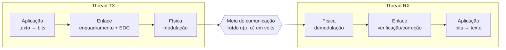

# Simulador de Redes — TR1

[](https://github.com/R2JustWind/Trabalho_Tr1/actions/workflows/tests.yml)


Trabalho final de **Teleinformática e Redes 1 (UnB)**. Um chat de texto que simula
a comunicação entre um transmissor e um receptor passando pelas camadas de
**aplicação**, **enlace** e **física**, com um meio de comunicação que adiciona
ruído gaussiano ao sinal.

## Como funciona



O transmissor e o receptor rodam em threads separadas e só se comunicam pelo meio.

## Técnicas implementadas

| Camada | Técnicas |
|---|---|
| **Enlace — enquadramento** | Contagem de caracteres · Entrelaçamento de bits · Byte stuffing · Bit stuffing |
| **Enlace — detecção de erros** | Bit de paridade par · Checksum · CRC-32 (IEEE 802) |
| **Enlace — correção de erros** | Código de Hamming |
| **Física — banda base** | NRZ-Polar · Manchester · Bipolar |
| **Física — portadora** | ASK · FSK · 8PSK · 32-QAM |
| **Meio de comunicação** | Ruído AWGN com média e desvio padrão configuráveis |

Os algoritmos são implementados do zero, sem bibliotecas externas.

## Estrutura

```
interface/          interface gráfica GTK e camada de aplicação (texto ↔ bytes)
enlace/
  CamadaEnlace.py   entrada da camada: configuração, transmissão e recepção
  enquadramento.py  contagem, entrelaçamento, byte stuffing e bit stuffing
  deteccao.py       paridade, checksum e CRC-32
  correcao.py       Hamming
  bits.py           conversões entre bits, bytes e inteiros
simulador/
  Simulador.py      rotina principal com as threads TX e RX
  canal.py          meio de comunicação com ruído gaussiano
  fisica_provisoria.py  NRZ simples usado até a camada física ser integrada
tests/              testes de todas as partes
```

## Como executar

O projeto roda no Linux. No Windows, use o WSL (no Windows 11 ele já abre janelas gráficas).

**Instalar as dependências da interface** (Ubuntu/WSL):

```bash
sudo apt update
sudo apt install python3 python3-gi gir1.2-gtk-3.0 python3-matplotlib
```

**Abrir a interface:**

```bash
python3 -m interface.main
```

**Rodar os testes:**

```bash
python3 -m unittest discover -s tests -v
```

Os testes também rodam automaticamente no GitHub a cada push.

## Usando o simulador no código

```python
from enlace.CamadaEnlace import ConfiguracaoEnlace
from simulador.Simulador import ConfiguracaoSimulacao, Simulador

config = ConfiguracaoSimulacao(
    enlace=ConfiguracaoEnlace(enquadramento="bit_stuffing", controle_erro="hamming"),
    desvio_ruido=0.8,
)
resultado = Simulador(config).enviar("Olá, TR1!")

print(resultado.texto_recebido)
print([q.situacao.value for q in resultado.recepcao_enlace.quadros])
```

O resultado guarda a saída de cada etapa (bits, sinal transmitido, sinal com ruído
e situação de cada quadro), usada pela interface para mostrar os gráficos.

## Andamento

| Parte | Responsável | Situação |
|---|---|---|
| Camada de aplicação e interface | Kenji | ✅ base pronta · 🔄 integração com o simulador e gráficos |
| Camada de enlace | João | ✅ pronta e testada |
| Simulador e meio de comunicação | João | ✅ pronto, usando física provisória |
| Camada física | Arthur | 🔄 em desenvolvimento |
| Relatório | Todos | 🔄 em andamento |

## Equipe

- **João Gabriel** — camada de enlace, simulador e meio de comunicação
- **Kenji** — camada de aplicação e interface gráfica
- **Arthur** — camada física
